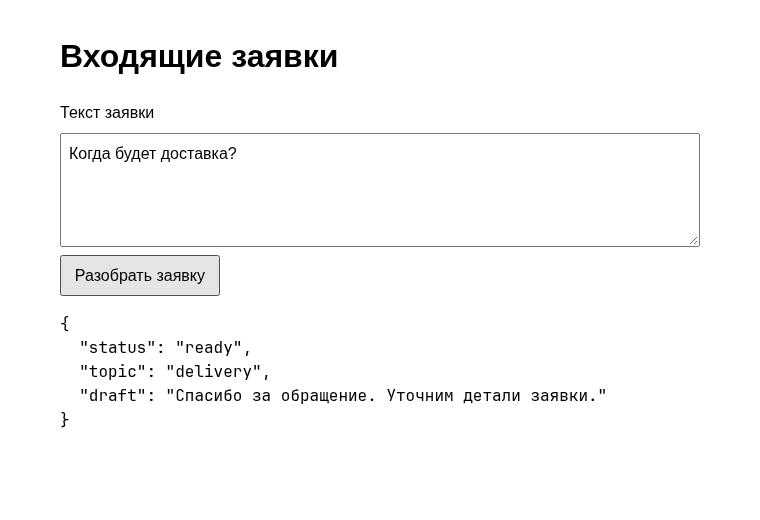
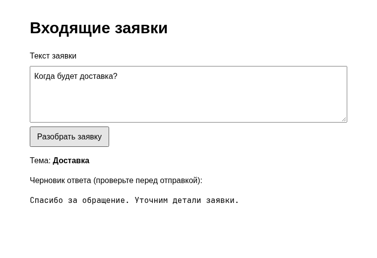
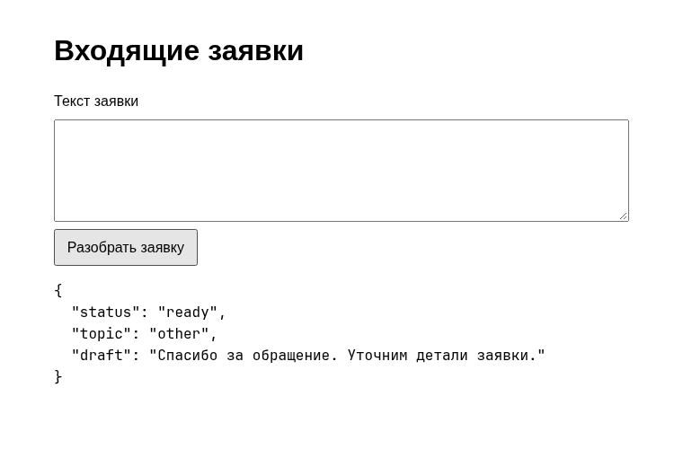
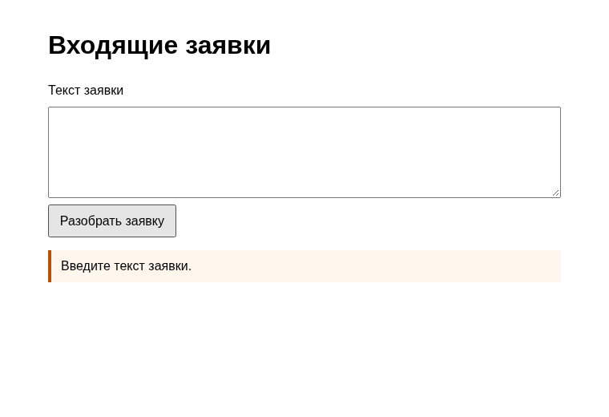
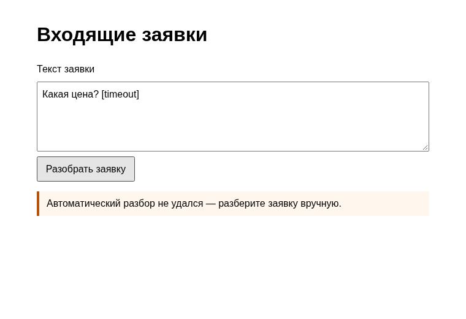
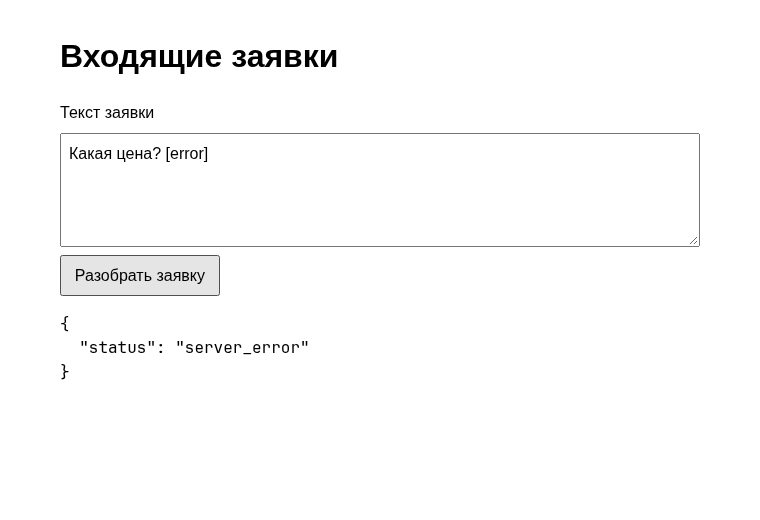
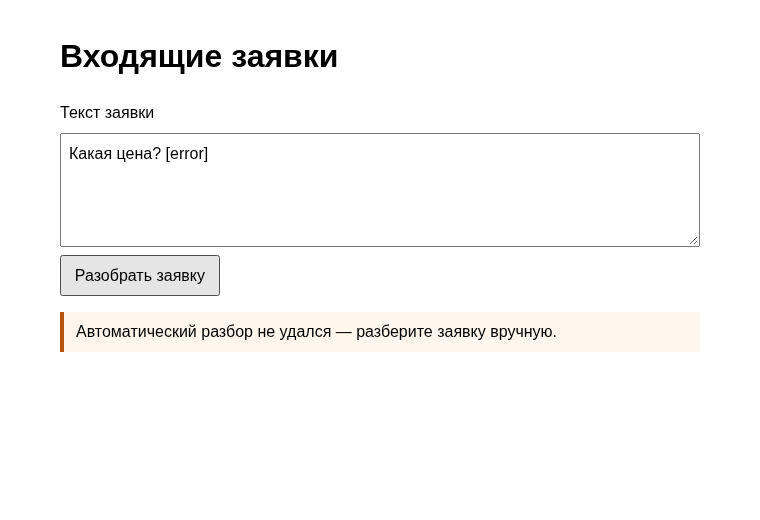
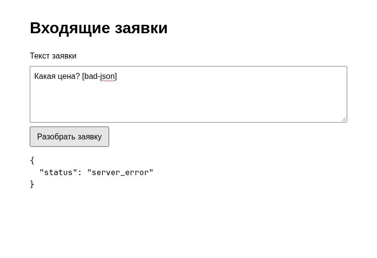
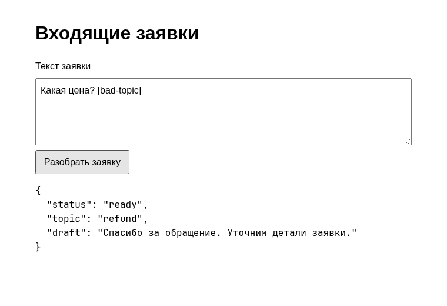
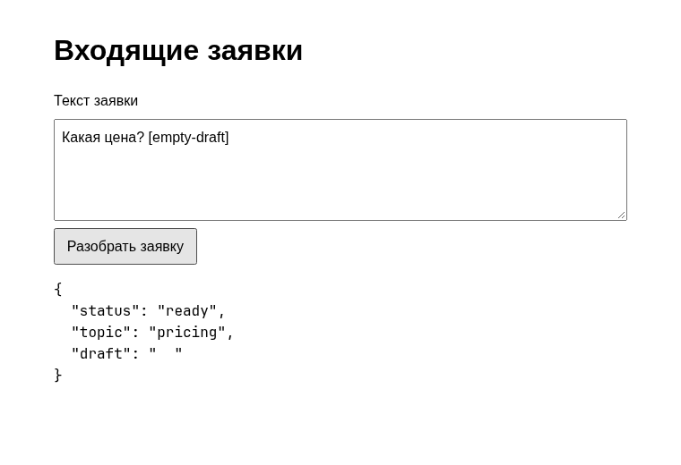

# Как было → как стало

Снимки сделаны Playwright в Chrome на двух живых серверах: слева выданный код (коммит `a9a2f68`), справа решение. В сценариях сбоя менеджер сначала разбирает обычную заявку «Какая цена?» (на экране появляется черновик), затем отправляет заявку со сбоем — видно, остаётся ли старый черновик. Повторить: запустить решение на порту 3000 и выданный код (`git worktree add ../before a9a2f68`) на 3001, затем `node evidence/make-screenshots.mjs evidence/screenshots` (нужен установленный Chrome).

| Сценарий | Было | Стало |
|---|---|---|
| **Обычная заявка** «Когда будет доставка?» | менеджер видит сырой JSON | тема словами («Доставка») и черновик |
| |  |  |
| **Пустой ввод** (одни пробелы) | модель вызвана, «готовый» черновик на пустую заявку | «Введите текст заявки.», API — 400 |
| |  |  |
| **Модель зависла** `[timeout]` | ждали 1,2 с и показали ответ как готовый | через 300 мс — «разберите вручную», черновика нет |
| |  |  |
| **Модель упала** `[error]` | `server_error` (HTTP 500) сырым JSON | «разберите вручную» (HTTP 200 `manual_review`) |
| |  |  |
| **Модель вернула не JSON** `[bad-json]` | `server_error` (HTTP 500) | «разберите вручную» |
| |  |  |
| **Чужая тема** `[bad-topic]` | тема `refund` ушла менеджеру как готовая | «разберите вручную» |
| |  |  |
| **Пустой черновик** `[empty-draft]` | «готово» с черновиком из пробелов | «разберите вручную» |
| |  |  |

Во всех сценариях сбоя справа черновик предыдущей заявки стёрт; это же проверяют e2e-тесты (`e2e/triage.spec.mjs`).
